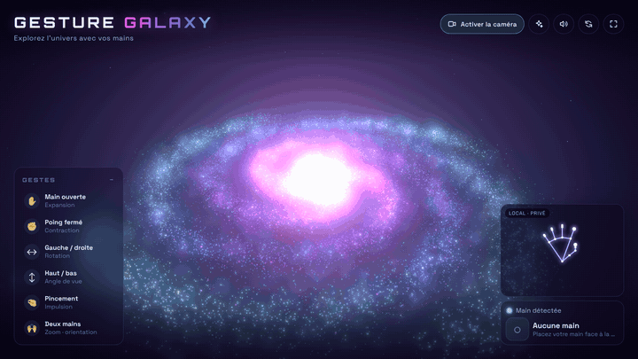
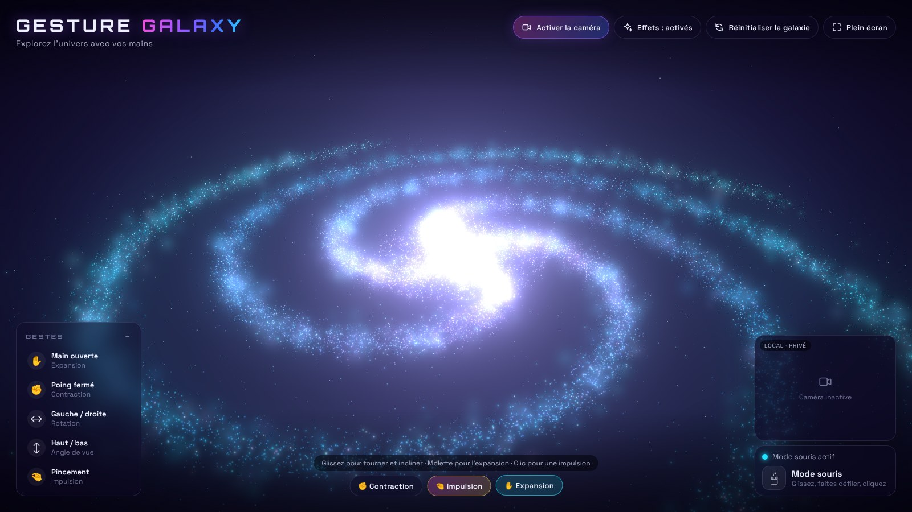
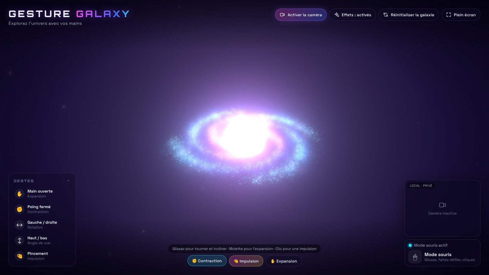
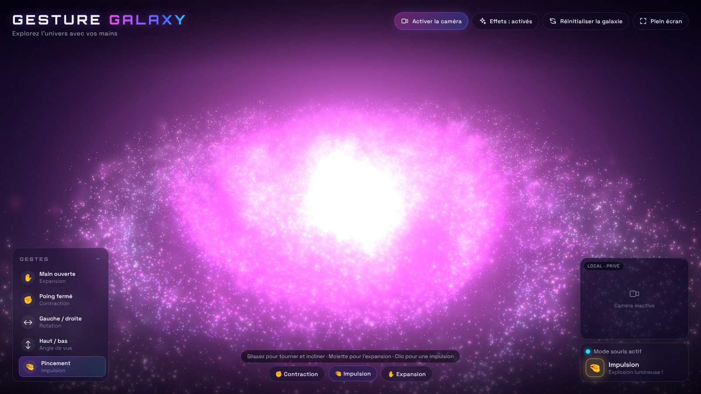
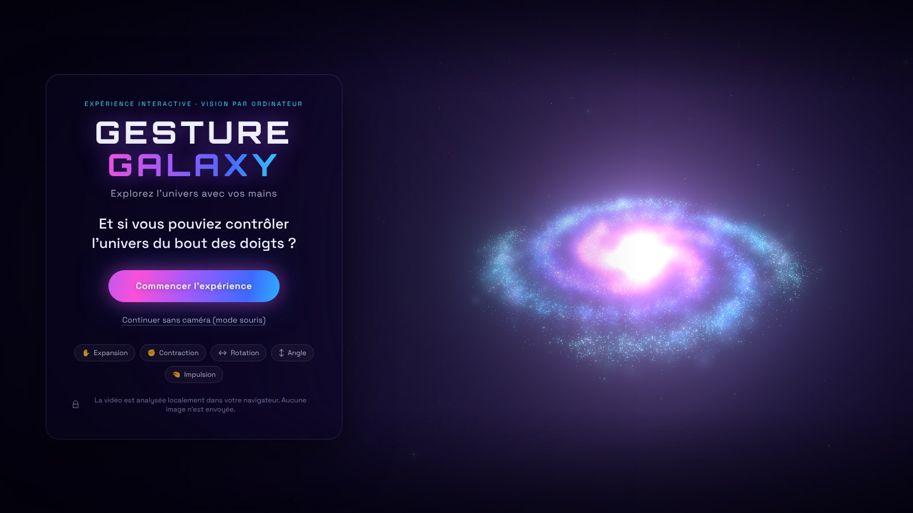

<div align="center">

# ✋ GESTURE GALAXY

**Explorez l'univers avec vos mains.**

Une galaxie spirale 3D de dizaines de milliers d'étoiles, pilotée en temps réel par les mouvements de votre main, détectés par votre webcam, directement dans le navigateur.

[**▶ Essayer la démo**](https://alirezazare79.github.io/gesture-galaxy/) · [Signaler un problème](../../issues)




</div>

---

## Le concept

> Et si vous pouviez contrôler l'univers du bout des doigts ?

GESTURE GALAXY est une expérience web interactive : vous ouvrez la page, vous autorisez la webcam, et votre main devient une télécommande cosmique. Ouvrez la main et la galaxie se déploie, fermez le poing et toutes les étoiles plongent vers le noyau, pincez les doigts et une onde de lumière traverse le disque.

Pas de souris, pas de clavier, pas d'installation : tout fonctionne dans le navigateur. La vidéo de la webcam est analysée **localement** sur votre ordinateur et n'est jamais envoyée sur Internet.

## Fonctionnalités

- 🌌 **Galaxie spirale 3D** à 4 bras : jusqu'à 28 000 étoiles (adapté automatiquement à l'appareil), nébuleuses, noyau lumineux, fond étoilé et effet de *bloom*.
- 🎨 **Palette futuriste** en dégradé : violet, bleu électrique, rose et cyan.
- ✋ **5 gestes à une main + gestes à deux mains** reconnus en temps réel grâce aux 21 points de repère de chaque main (MediaPipe).
- 🙌 **Deux mains** : écartez-les pour plonger dans la galaxie, tournez-les comme un volant pour l'orienter.
- 🔊 **Ambiance sonore réactive**, entièrement synthétisée (Web Audio, aucun fichier audio) : nappe spatiale, grondement à la contraction, scintillement à l'expansion, explosion au pincement.
- 🎯 **Reconnaissance stable** : lissage *One Euro*, zone morte, hystérésis, confirmation sur plusieurs images, temporisation des impulsions et gestion des pertes de détection.
- 🖱 **Mode alternatif sans caméra** : souris, tactile et clavier.
- 🔒 **100 % local** : aucune image ne quitte votre navigateur, aucun serveur nécessaire.
- ⚡ **Performances adaptatives** : l'animation des particules est calculée sur le GPU (shaders), et la résolution et le nombre d'étoiles s'ajustent si l'ordinateur peine.
- 📱 **Interface responsive** en français, plein écran, activation/désactivation des effets visuels.

## Les gestes

| Geste | Action sur la galaxie |
| --- | --- |
| ✋ **Main ouverte** | Expansion : les étoiles s'éloignent du centre, la galaxie s'agrandit et les bras spiraux se dessinent nettement. |
| ✊ **Poing fermé** | Contraction : les étoiles sont aspirées en tourbillon vers le noyau, qui s'embrase. |
| ↔ **Déplacement gauche / droite** | Rotation de la galaxie ; la vitesse dépend de la vitesse de votre main, avec inertie. |
| ↕ **Déplacement haut / bas** | Changement d'angle de vue : main haute, vue plongeante ; main basse, contre-plongée. |
| 🤏 **Pincement pouce / index** | Impulsion lumineuse et sonore : explosion radiale, onde de choc et changement temporaire de couleur. **Une seule impulsion par pincement.** |
| 🙌 **Deux mains : écarter / rapprocher** | Zoom avant / arrière : on plonge au cœur de la galaxie. |
| 🙌 **Deux mains : tourner comme un volant** | Rotation de la galaxie dans le plan de l'écran. |

### Mode souris, tactile et clavier

| Action | Souris / tactile | Clavier |
| --- | --- | --- |
| Rotation | Glisser horizontalement | ← → |
| Angle de vue | Glisser verticalement | ↑ ↓ |
| Expansion / contraction | Molette ou boutons « Expansion » / « Contraction » | + / − |
| Impulsion | Clic / tap ou bouton « Impulsion » | Espace |
| Zoom | Maj + molette, ou pincement sur pavé tactile | — |
| Orientation | — | Q / D |
| Réinitialiser · Plein écran · Effets · Son | Boutons en haut à droite | R · F · E · M |


## Captures d'écran

| Expansion (main ouverte) | Contraction (poing fermé) | Impulsion (pincement) |
| --- | --- | --- |
|  |  |  |



## Technologies

| Technologie | Rôle |
| --- | --- |
| [Three.js](https://threejs.org/) | Scène 3D, particules (`BufferGeometry` + `Points`), post-traitement (bloom) |
| WebGL / GLSL | Shaders personnalisés : toute l'animation des étoiles est calculée sur le GPU |
| Web Audio API | Ambiance sonore générée en temps réel (oscillateurs, bruit filtré, réverbération) |
| [MediaPipe Hand Landmarker](https://ai.google.dev/edge/mediapipe/solutions/vision/hand_landmarker) | Détection de la main et de ses 21 points de repère (modèle pré-entraîné publié par Google) |
| TypeScript | Code typé et structuré |
| Vite | Serveur de développement et build de production |
| HTML5 / CSS3 | Interface (glassmorphism, animations, responsive) |
| GitHub Actions + GitHub Pages | Déploiement automatique |

La reconnaissance des gestes elle-même (ouverture de la main, poing, pincement, mouvements) est une couche d'analyse géométrique écrite pour ce projet, au-dessus des points de repère fournis par MediaPipe.

## Installation

Prérequis : [Node.js](https://nodejs.org/) **20.19 ou plus récent** (22 recommandé) et une webcam (facultative).

```bash
git clone https://github.com/alirezazare79/gesture-galaxy.git
```

```bash
cd gesture-galaxy
```

```bash
npm install
```

## Lancer le projet en local

```bash
npm run dev
```

Ouvrez ensuite l'adresse affichée (par défaut <http://localhost:5173>). Les navigateurs autorisent la webcam sur `localhost` sans HTTPS.

Au premier lancement, le modèle MediaPipe (~7,8 Mo) est téléchargé automatiquement dans `public/models/`.

Autres commandes :

| Commande | Description |
| --- | --- |
| `npm run build` | Vérification TypeScript + build de production dans `dist/` |
| `npm run preview` | Sert le build de production localement |
| `npm test` | Tests unitaires de la reconnaissance des gestes |
| `npm run test:e2e` | Test de bout en bout dans Chromium (nécessite Playwright, voir plus bas) |

Paramètres d'URL utiles : `?particles=15000` (nombre d'étoiles), `?quality=max` (désactive l'adaptation automatique de la qualité).

## Déploiement sur GitHub Pages

Le dépôt contient un workflow prêt à l'emploi : [`.github/workflows/deploy.yml`](.github/workflows/deploy.yml). À chaque `push` sur la branche `main`, il :

1. installe les dépendances (`npm ci`) ;
2. lance les tests unitaires ;
3. construit le projet avec le bon chemin de base, calculé automatiquement à partir du nom du dépôt (ou de votre domaine personnalisé) ;
4. publie le dossier `dist/` sur GitHub Pages.

Pour l'activer : **Settings → Pages → Build and deployment → Source : GitHub Actions**. La démo est ensuite disponible à l'adresse `https://alirezazare79.github.io/gesture-galaxy/`, en HTTPS : la webcam y fonctionne.

> Le chemin de base Vite est relatif (`./`) en local et fourni par le workflow (`BASE_PATH`) lors du déploiement : vous pouvez renommer le dépôt sans rien modifier.

## Confidentialité

- Le flux de la webcam est analysé **uniquement dans votre navigateur** (WebAssembly + WebGL). Aucune image, aucune vidéo et aucune donnée de la main n'est envoyée à un serveur.
- Aucun cookie, aucun traceur, aucune statistique d'utilisation.
- Seuls des fichiers statiques sont téléchargés : la page, le moteur MediaPipe et le modèle de détection, servis par le site lui-même (repli sur le serveur officiel de Google pour le modèle s'il était absent).
- La caméra s'arrête dès que vous cliquez sur « Désactiver la caméra » ou fermez la page.

## Architecture

```
gesture-galaxy/
├── .github/workflows/deploy.yml   # Build + déploiement GitHub Pages
├── docs/                          # Captures d'écran du README
├── public/
│   ├── favicon.svg
│   ├── og-image.jpg               # Aperçu pour LinkedIn / réseaux sociaux
│   └── models/                    # Modèle MediaPipe (téléchargé automatiquement)
├── scripts/
│   ├── fetch-model.mjs            # Téléchargement du modèle Hand Landmarker
│   └── smoke-test.mjs             # Test de bout en bout (Playwright)
├── src/
│   ├── main.ts                    # Orchestration : démarrage, boucle d'animation, modes
│   ├── style.css                  # Interface
│   ├── components/
│   │   ├── Galaxy.ts              # Scène Three.js, particules, bloom, physique des commandes
│   │   ├── HandTracker.ts         # Webcam + MediaPipe (chargé à la demande)
│   │   ├── GestureController.ts   # Points de repère → gestes stables et commandes
│   │   ├── TwoHandController.ts   # Gestes à deux mains : zoom et orientation
│   │   ├── SoundEngine.ts         # Ambiance sonore synthétisée (Web Audio)
│   │   ├── MouseController.ts     # Mode souris / tactile / clavier
│   │   └── Interface.ts           # DOM : écrans, indicateurs, squelette de la main
│   ├── shaders/galaxyShaders.ts   # Shaders GLSL (animation GPU des étoiles)
│   └── utils/
│       ├── gestureUtils.ts        # Géométrie de la main, classification, filtre One Euro
│       └── device.ts              # Qualité adaptative, WebGL, plein écran
├── tests/                         # Tests unitaires (node:test) + mains synthétiques
├── index.html
├── package.json · tsconfig.json · vite.config.ts
└── README.md · LICENSE
```

Le flux de données est volontairement simple et découplé :

```
Webcam → HandTracker (MediaPipe, ~30 analyses/s, jusqu'à 2 mains)
       ├─ 1 main  → GestureController (lissage, gestes)
       └─ 2 mains → TwoHandController (zoom, orientation)
              → main.ts (traduction en commandes) → Galaxy (ressorts amortis → uniforms GPU)
                                                  → SoundEngine (paramètres audio)
Souris/clavier → MouseController ──────────────────┘
```

`GestureController`, `TwoHandController` et `gestureUtils` n'ont aucune dépendance au DOM ni à Three.js : ils sont testés unitairement avec des mains synthétiques (poing, main ouverte, pincement, index pointé, poing avec le pouce sur l'index…).

## Tests

```bash
npm test
```

Le test de bout en bout lance un vrai navigateur avec une **caméra simulée** par Chromium : il vérifie le chargement de MediaPipe et du modèle, les messages d'erreur (caméra refusée, absente, occupée, page non sécurisée), le mode souris, l'affichage mobile et la chaîne gestuelle complète avec des points de repère simulés.

```bash
npm install --no-save playwright
```

```bash
npx playwright install chromium
```

```bash
BASE_PATH=/gesture-galaxy/ npm run build && BASE_PATH=/gesture-galaxy/ npm run test:e2e
```

## Dépannage

- **« Connexion non sécurisée »** : la webcam exige HTTPS ou `localhost`. Utilisez `npm run dev` ou la version publiée.
- **« Accès à la caméra refusé »** : cliquez sur l'icône de cadenas dans la barre d'adresse, autorisez la caméra, puis « Réessayer ».
- **La détection est instable** : placez-vous face à une lumière, gardez toute la main dans le cadre, à 40–80 cm de la caméra.
- **Animation saccadée** : désactivez les effets visuels (bouton ou touche E) ; la qualité s'adapte aussi automatiquement.

## Améliorations futures

- Mode « création » : dessiner de nouvelles étoiles du bout de l'index.
- Plusieurs univers (nébuleuse, trou noir, amas globulaire) et transitions entre eux.
- Enregistrement d'une courte vidéo de la session directement depuis l'application.
- Traitement de la vidéo dans un Web Worker pour libérer encore plus le fil principal.
- Calibration personnalisée des seuils de geste.

## Crédits et licence

- Code sous licence [MIT](LICENSE).
- [Three.js](https://github.com/mrdoob/three.js) — licence MIT.
- [MediaPipe](https://github.com/google-ai-edge/mediapipe) et le modèle Hand Landmarker — © Google, licence Apache 2.0.
- Polices [Orbitron](https://fonts.google.com/specimen/Orbitron) et [Space Grotesk](https://fonts.google.com/specimen/Space+Grotesk) — SIL Open Font License, auto-hébergées via Fontsource.
